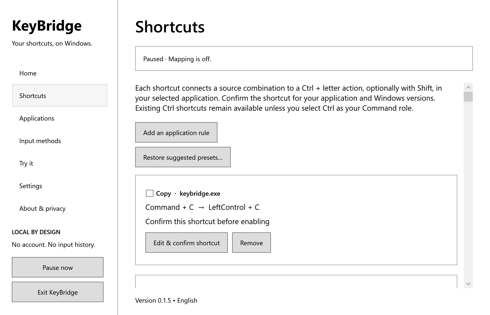

<div align="center">


# KeyBridge

**Your shortcuts, on Windows.**

Bring familiar Command-style shortcuts to your Windows desktop, with application-specific settings and private, local processing.

[Download for Windows](https://github.com/shoutoutuoadi325/keybridge/releases/latest) · [Getting started](#getting-started) · [Privacy](docs/PRIVACY.md) · [Support](#support)

</div>

## Download

**[Download KeyBridge 0.1.5 for Windows x64](https://github.com/shoutoutuoadi325/keybridge/releases/download/v0.1.5/KeyBridge-0.1.5-win-x64.zip)**

Extract the entire ZIP to a folder of your choice, then open **KeyBridge.exe**. The download includes the .NET runtime, so no separate runtime installation is required. Keep the extracted files together.

Requires **Windows 11, an x64 processor and a physical keyboard**. The interface is in English. [Release notes and checksums](https://github.com/shoutoutuoadi325/keybridge/releases/latest) are available with each download.

## Familiar shortcuts. Your choice.

- **Choose your Command key.** Use a physical Alt, Ctrl or Windows key as your preferred shortcut modifier.
- **Personalize each application.** Start with presets for Microsoft Edge, Google Chrome and Visual Studio Code, or create your own application shortcuts.
- **Preview before enabling.** Explore shortcuts in the built-in editor or their selected application, then confirm the settings you want to use.
- **Stay in control.** Pause from the window, notification area or a configurable emergency shortcut. Exit stops KeyBridge completely.
- **Keep your settings local.** Import and export application shortcuts, exclusions and preferences using files you choose.
- **Keep your input private.** Keyboard processing stays on your computer, without keyboard-history recording, clipboard reading or input uploads.



## Getting started

1. Open **KeyBridge.exe** and review the local processing information on **Home**.
2. Choose a Command role, select **Confirm role with a physical key**, and press the selected key.
3. Press your emergency pause shortcut to confirm it. The default is **Ctrl + Alt + F10**; you can choose another combination in **Settings** if Windows already uses it. F12 and protected input-method shortcuts are unavailable as recovery shortcuts.
4. Select the **ENG US** keyboard layout and open **Try it** to preview editing shortcuts in the local editor.
5. Open **Shortcuts**, choose the target application and configure your shortcuts. Preview the actions, confirm their settings, then save and enable them.
6. Select **Enable mapping** on Home. Use **Pause now** or your emergency shortcut whenever you want native keyboard behavior.

Closing the window keeps KeyBridge in the notification area. Use **Exit KeyBridge** to close it completely.

## Shortcut examples

Your selected physical role key acts as **Command** in these examples.

| Action | Source | Windows action |
| --- | --- | --- |
| Select all | Command + A | Ctrl + A |
| Copy | Command + C | Ctrl + C |
| Paste | Command + V | Ctrl + V |
| Cut | Command + X | Ctrl + X |
| Undo | Command + Z | Ctrl + Z |
| Find | Command + F | Ctrl + F |
| Save | Command + S | Ctrl + S |
| Redo in Visual Studio Code | Command + Shift + Z | Ctrl + Shift + Z |

Targets can be customized for each application. Browser presets use **Ctrl + Y** for redo.

## How KeyBridge works

KeyBridge applies your confirmed shortcuts to the selected application using the ENG US layout. Replacement actions use **Ctrl plus a letter**, optionally with **Shift**, in ordinary-permission windows. Application and Windows version settings keep shortcuts tied to the context you configured.

Windows security shortcuts, Microsoft Pinyin, other keyboard layouts and elevated windows retain native input behavior. Existing Ctrl shortcuts remain available unless you choose Ctrl as your Command role. The selected role and application settings are shared across connected keyboards.

KeyBridge starts paused, so you choose when mapping runs. The Microsoft Store edition also supports optional Windows-managed login startup. The GitHub ZIP edition opens directly from its extracted folder.

## Privacy

KeyBridge runs without administrator access, drivers or services. It does not record keyboard history, read clipboard or document contents, upload input, or include accounts, ads or automatic telemetry. Settings and optional diagnostic exports stay local.

Read the [privacy policy](docs/PRIVACY.md) for details about local settings and your controls.

## Support

Report bugs and request features through [GitHub Issues](https://github.com/shoutoutuoadi325/keybridge/issues). Include the KeyBridge version, Windows version, application and steps to reproduce. Use sample text and omit private input or sensitive files.

For product support and privacy questions, contact **zhiqizhangg@gmail.com**. Published by **Zhiqi Zhang**.

## Build from source

Use the **.NET 10 SDK** on Windows 11:

```powershell
git clone https://github.com/shoutoutuoadi325/keybridge.git
cd keybridge
./scripts/Build.ps1
./scripts/Run.ps1
```

Build and Run accept `-DotNetPath` when the SDK is installed outside PATH. Build runs the core, platform and managed service harnesses.

Create the self-contained download package with:

```powershell
./scripts/Package-Portable.ps1 -Version 0.1.5
```

The script writes the Windows x64 ZIP and its checksum under `artifacts/packages`. For Microsoft Store packaging, see [packaging instructions](docs/STORE_RELEASE.md). [API references](docs/API_REVIEW.md) and the [configuration schema](docs/PROFILE_SCHEMA.md) describe the implementation.

## License

KeyBridge is free and open source under [GNU GPL v3](LICENSE). Distributed packages include the applicable [third-party notices](docs/THIRD_PARTY_NOTICES.md).

Apple and Microsoft names identify compatible platforms and applications; no affiliation is implied.
